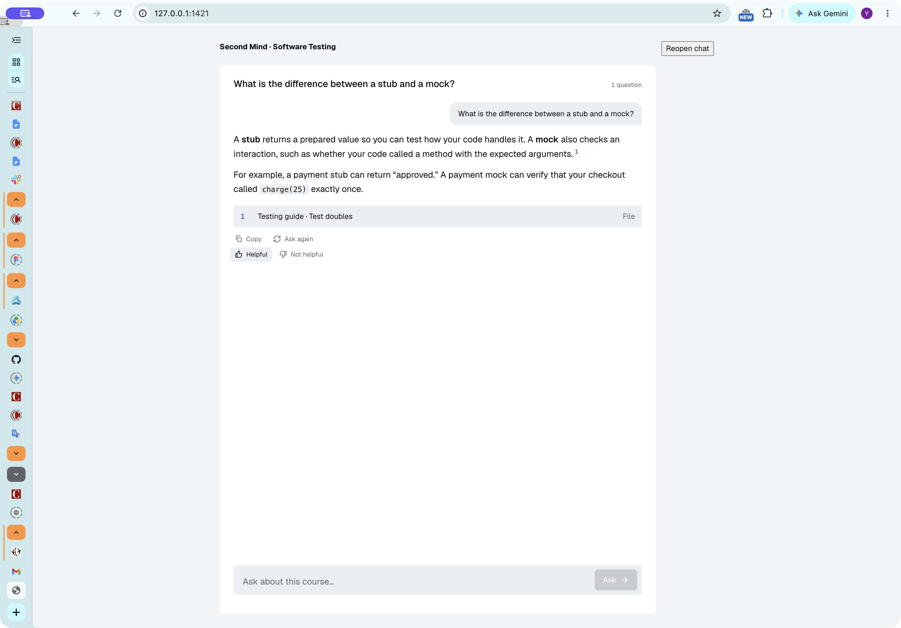
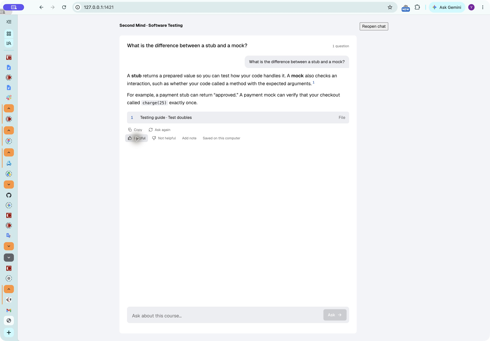
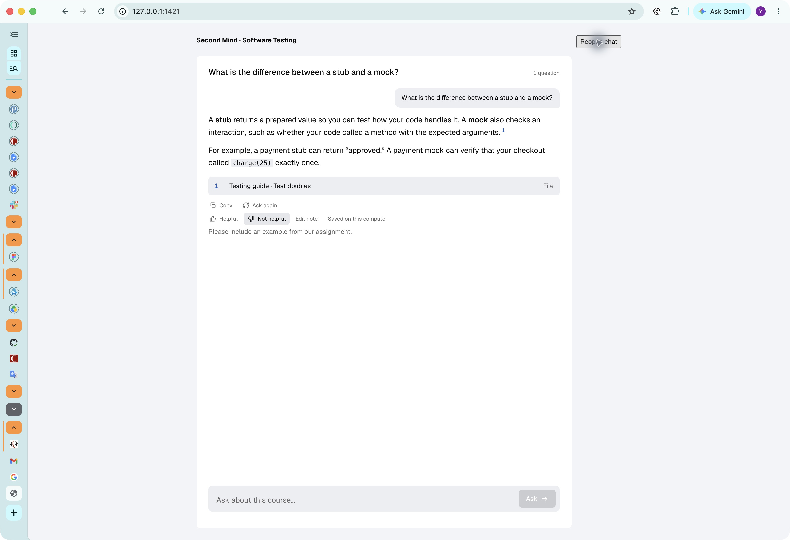

# Answer feedback verification — 2026-11-10

Task 2 of the [RAG gaps plan](../../plans/2026-11-09-rag-course-gaps.md).

## Automated checks

- Backend: `python -m pytest tests/ -q` — **593 passed, 9 skipped**.
  Covers save, replace, clear, legacy turns, note validation, course isolation,
  newest-first review listing, concurrent conversation/memory writes, and real
  HTTP requests. Stream tests cover failed answers and deleted conversations.
- Frontend: `npm test` — **5 passed**. Covers switching/removing ratings,
  restored notes, editing, failed writes, duplicate-click prevention, and the
  actual ChatPanel using a backend-supplied index after a failed answer.
- Frontend: `npm run build` — passed (TypeScript and Vite).
- Independent code review: no required fixes.

## Visual checks

Captured in Chrome using the real ChatPanel, Answer, AnswerFeedback, and app
stylesheet, with synthetic course content and a local fixture replacing the
Tauri HTTP bridge. The fixture saves to browser session storage so reopening
the chat exercises the same loading/rendering path. Actual local JSON-file
persistence and HTTP routing are covered by the backend tests above. These
screenshots do not claim a packaged Tauri end-to-end test.

Verified that Not helpful is selected, the optional note saves, and both
remain visible after reopening the chat. The three states are shown below.

Unrated:

Helpful:

Not helpful, with a note restored after reopening:

## Reviewing flagged answers

While the local backend is running, request
`GET http://127.0.0.1:8756/courses/{course_id}/feedback` for a selected course.
The `turns` array contains thumbs-down turns, newest feedback first, including
the question, answer, citations, conversation ID/title, saved turn index, and
feedback. Changing to Helpful or removing the rating removes it from this list.

Feedback is stored only in the existing local conversation JSON file. It is
not included in model or memory extraction inputs. This feature does not
change retrieval or answer generation; no answer-quality improvement is claimed.
